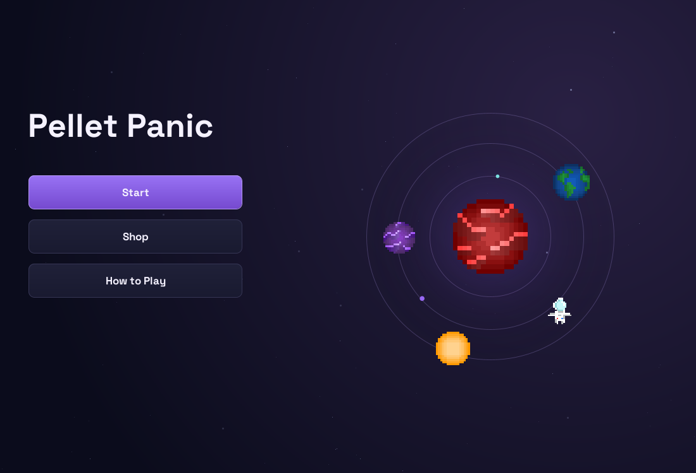
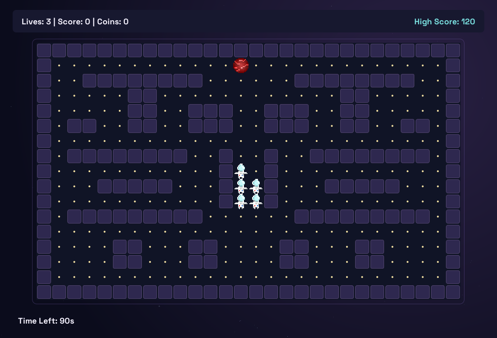
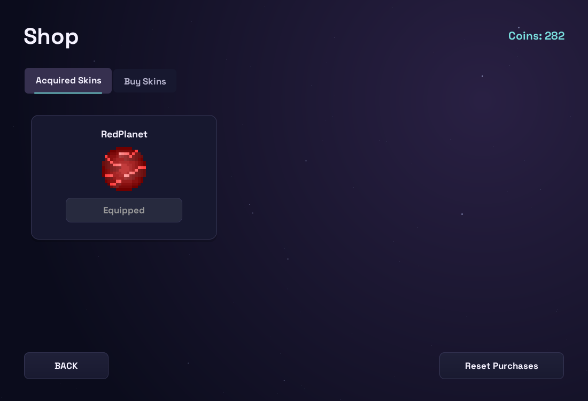
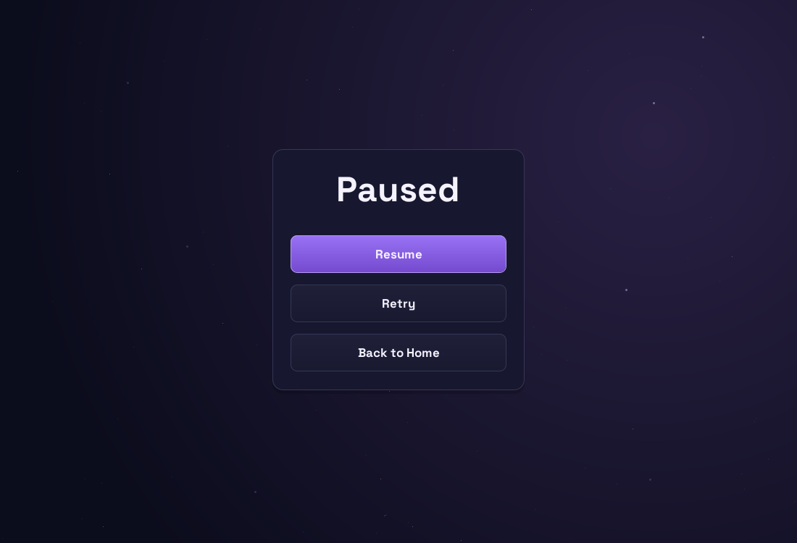

# Pellet Panic

A space-themed maze game built with Java Swing. Guide a planet through the maze,
collect pellets and coins, avoid astronauts, and use power-ups to survive. Spend
your coins on planet skins and try to beat your high score.

## Features

- Play three distinct mazes: open routes on Easy, branching paths on Medium, and
  narrow lanes with staggered crossings on Hard.
- Collect pellets for points and coins for the shop.
- Use freeze, invincibility, and fire-trail power-ups to gain an advantage.
- Choose from five planet skins: RedPlanet, BluePlanet, Earth, PurplePlanet, and Sun.
- Pause, resume, or retry a run.
- Listen to looping space music and gameplay sound effects, with mute and separate
  music/effect volume controls.
- Keep coins, high scores, purchased skins, equipped skins, and audio preferences
  in local save files. No separate database or account is required.

## Screenshots

Click a screenshot to view it at full size. These previews are rendered from the
game's included interface and maze layouts.

| Main menu | Gameplay |
| --- | --- |
| [](docs/previews/home.png) | [](docs/previews/gameplay.png) |
| Start a run, browse the shop, or open the instructions. | Collect pellets and coins while avoiding astronauts. |

| Planet shop | Pause menu |
| --- | --- |
| [](docs/previews/shop.png) | [](docs/previews/pause.png) |
| Buy skins with collected coins and choose a planet to equip. | Resume the run, retry the same difficulty, or return home. |

## Run from source

The included setup and run commands are for **Windows**.

### Requirements

- A full **JDK 17 or newer**, including `java`, `javac`, and `jar`. A JRE alone is
  not enough to build the source. You can get a JDK from
  [Eclipse Temurin](https://adoptium.net/temurin/releases/).
- **Windows PowerShell 5.1 or newer**.
- Optional: **Visual Studio Code** with the **Extension Pack for Java**.

### Installation

1. Download this repository using **Code > Download ZIP**, then extract it, or
   clone it with Git.
2. Install the JDK and make sure its `bin` directory is on PATH, or set
   `JAVA_HOME` to the JDK installation directory. Open a new terminal afterward.
3. Open a PowerShell terminal in the extracted project folder and check Java:

   ```powershell
   java -version
   javac -version
   jar --version
   ```

4. Build and start the game:

   ```powershell
   powershell -NoProfile -ExecutionPolicy Bypass -File .\scripts\project.ps1 Run
   ```

The command builds `dist/PelletPanic.jar` and starts the game. Images, fonts,
music, and effects are bundled automatically; no extra libraries or downloads are
needed after obtaining the project and JDK.

### Run in VS Code

1. Open the entire project folder with **File > Open Folder**.
2. Install the recommended **Extension Pack for Java**, or use:

   ```powershell
   code --install-extension vscjava.vscode-java-pack
   ```

3. Let Java finish loading the project. If asked, use standard mode.
4. Press **F5** and choose **Debug Pellet Panic**. The game builds before opening.

You can also use **Terminal > Run Task > Pellet Panic: run**. Press
**Ctrl+Shift+B** to build without starting the game.

### Run the built JAR

To build without launching:

```powershell
powershell -NoProfile -ExecutionPolicy Bypass -File .\scripts\project.ps1 Build
```

Then run from the project folder:

```powershell
java -jar .\dist\PelletPanic.jar
```

## How to play

Choose **Start**, select a difficulty, collect pellets, and avoid astronauts.
You have three lives. Losing all lives or running out of time ends the run.
Clearing the maze starts another round. Coins can be spent in **Shop** to buy
and equip skins; power-ups activate when collected.

| Difficulty | Time per round | Astronauts |
| --- | --- | --- |
| Easy | 120 seconds | 4 |
| Medium | 90 seconds | 5 |
| Hard | 90 seconds | 6 |

## Controls

| Action | Input |
| --- | --- |
| Change direction | Arrow keys, on release |
| Pause / resume | Space |
| Restart after game over | R |
| Return home after game over | Esc |
| Resume, retry, or return home while paused | Pause-menu buttons |
| Mute / unmute audio | M or click the speaker icon |
| Adjust music and effects separately | Right-click the speaker icon |

## Saves and setup help

Progress is stored in `data/player-1.properties`, with the previous save kept as
`player-1.properties.bak`. Audio preferences use `data/audio.properties`. The
run script and VS Code use the project folder for saves; copy `data/` when moving
the game to keep your progress. Scores and collected coins save when a run ends;
leaving an unfinished run discards that run's score and collected coins.

- **Java command not found:** install a full JDK, check `JAVA_HOME`/PATH, then
  reopen the terminal and VS Code.
- **Compiler does not support release 17:** select JDK 17 or newer.
- **Save folder already in use:** close the other game instance before opening
  another one with the same save folder.
- **No sound:** check mute, both volume levels, and your system audio output.
  The game remains playable without an available sound device.
- **Want a fresh save:** close the game and rename the `data` folder to keep a
  backup. The next launch creates fresh progress.

## Credits

- **Music:** [Outer Space Loop](https://opengameart.org/content/outer-space-loop)
  by **wipics**, released under **CC0 1.0**.
- **Sound effects:** [Sci-Fi Sounds](https://kenney.nl/assets/sci-fi-sounds) and
  [Interface Sounds](https://kenney.nl/assets/interface-sounds) by **Kenney**,
  released under **CC0 1.0**. Selected sounds were converted to PCM WAV for Java
  playback. [Audio credits](src/Audio/CREDITS.txt) and
  [CC0 license](src/Audio/CC0-1.0.txt) are included with the source and game JAR.
- **Font:** [Space Grotesk](https://github.com/floriankarsten/space-grotesk),
  copyright 2020 **The Space Grotesk Project Authors**, licensed under the
  [SIL Open Font License 1.1](src/Fonts/OFL.txt). Regular and bold fonts are bundled.
